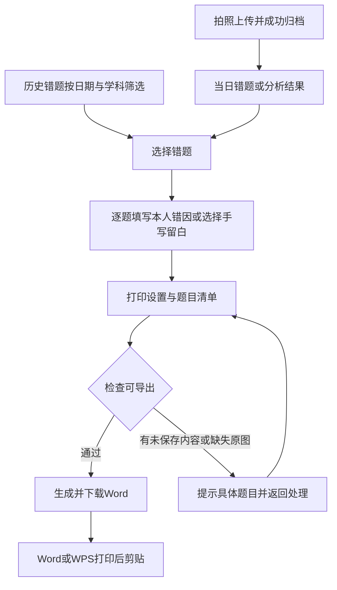

# 每日错题整理与剪贴打印 PRD

**文档类型：** PRD
**需求类型：** 迭代型
**版本：** v0.1.0 · **创建时间：** 2026年11月11日 20:21:19（北京时间） · **状态：** 核心范围本地开发及可用资料验证完成，未发布；纸面效果待验收

## 修改记录

| 版本 | 时间 | 改动说明 | 修改人 |
|---|---|---|---|
| v0.1.0 | 2026年11月11日 20:21:19（北京时间） | 根据用户提供的群聊截图，结合现有代码整理增量需求、打印规则、多孩方案及验收标准 | AI 协助整理 |
| v0.1.0 | 2026年11月11日 21:12:37（北京时间） | 根据用户“开始按照计划开发”授权采纳REQ-DP01～DP06与推荐默认值；多孩仍待决；同步本地实施状态 | AI 协助整理 |

## AI 速读卡

- 目标：把当天多个上传批次的错题汇总，填写学生自己的错因，生成可编辑、可打印、可剪贴的 Word。
- 用户：整理作业的家长、需要提交纸质错题本的学生；教师是纸质产物的接收方。
- 核心变更：按天筛选和整组选题、本人错因持久保存、剪贴打印模板；复用现有识别、原图与 Word 能力。
- 本次批准范围：REQ-DP01～REQ-DP06；多孩档案REQ-DP07仍为独立待决项，不改变账号与收费规则。
- 硬约束：原题完整；学生反思与 AI 解析分开；账号数据隔离；无额外 AI 调用的整理与打印。
- 用户已要求按计划开发，本次采用文档推荐的日期口径、编辑范围和默认打印数值。
- 配套技术方案：[TECH](daily-mistake-printing/TECH.md)；实际进度与证据见[交付记录](../../delivery/features/daily-mistake-printing.md)。

## 一、需求背景

### 1.1 反馈依据

来源为本次用户提供的微信群聊长截图，截图显示“11月6日”的聊天时间，年份未显示。图片已直接阅读；只摘录与功能有关的内容，不复制头像、昵称、群成员资料或原图进仓库。

| 来源中的诉求 | 需求解释 | 依据性质 |
|---|---|---|
| 老师要求把错题写到错题本，题目旁还要写“当时是错误的原因是什么” | 纸质错题材料应同时容纳原题和学生本人的反思 | 截图明确提出 |
| 选择当天整理的试卷，拍进去，把错题归档到一起，“再编辑打印出来，直接贴到错题本上” | 跨上传批次按天汇总、选题、补充内容、合并排版导出 | 截图明确提出 |
| 小型打印机的纸贵，打印字小、不合适 | 优先适配普通打印纸和可读字号，减少重复抄题 | 截图中的用户体验反馈；耗材价格未独立核实 |
| 一个账号可否选择两三个孩子，按不同年级存储 | 家庭多个学习档案及快捷切换 | 截图明确提出的扩展设想 |
| 有人认为会增加复杂度，有人主张“一个孩子一个账号” | 多孩与商业模式存在分歧 | 截图明确存在争议，不能视为结论 |

### 1.2 问题：已验证现状与变更

| 能力 | 当前代码事实 | 本次增量 |
|---|---|---|
| 拍照识别归档 | `app/api/analyze/route.ts` 每次接收1～4张 JPG/PNG/WEBP，单张最多8MB，分析成功后保存上传与错题 | 继续复用；“一天多张”通过多次上传完成，不擅自扩大单次限制 |
| 日期与搜索 | `app/dashboard.tsx` 支持学科、月份、关键词，按 `createdAt.slice(0,10)` 分组 | 增加北京时间的精确日期/区间、今日入口、按日选题 |
| 多题 Word | 已支持勾选多题合并；1～30题且非WEBP优先走服务端，其余走浏览器转换 | 增加打印设置及剪贴模板，各生成路径保持一致 |
| 数学与图表 | 已有公式、原题区域及原图保留逻辑 | 保持题干、公式、图表完整，不能因剪贴排版丢失 |
| 错因 | `mistakes.reasoning` 是解题思路；普通错题接口只有读取和删除，没有学生错因字段和编辑接口 | 新增独立的“我的错因”保存能力 |
| 多孩 | 当前业务数据按 `user_id` 归属；没有学习档案模型 | 属于跨模块变更，单列决策与覆盖边界 |

### 1.3 价值与时机

目的与价值：减少家长替孩子重复抄题和逐题排版的工作，同时保留孩子思考错因的环节。已有识别和合并 Word 可复用，本次主要补齐“从电子归档到纸质错题本”的最后一段流程。节省时间、使用频率和付费意愿目前没有统计基线，不能据单条反馈推算市场规模。

## 二、用户与场景分析

| 角色 | 场景与痛点 | 目标行为 |
|---|---|---|
| 家长 | 晚上整理同一天的几份作业，错题来自多个上传批次 | 选中今天、按学科筛选、整组选中，合并输出 |
| 学生 | 老师要求反思；只打印答案不能满足要求 | 逐题输入自己的错因，或打印留白后手写 |
| 学生与家长 | 数学题包含图形，抄题容易漏图或抄错公式 | 保留完整原题，使用可读字号打印并剪贴 |
| 家长 | 周末补整理历史资料 | 选择具体日期或日期区间，保留各题来源与日期 |
| 多孩家长 | 不同孩子年级和资料混在同一设备使用 | 在选定账号方案后，快速切换且隔离所有学习资料 |

现状路径：上传分析 → 浏览错题 → 手工寻找当天题目 → 逐题确认 → 合并 Word → 自行补反思和调整版式 → 打印。

目标路径：上传分析 → 今日/指定日期错题 → 选题 → 填写或留白错因 → 打印设置 → 下载 Word → 普通打印机打印 → 剪贴、手写反思或订正。

## 三、目标与成功指标

业务成功指标包括整理完成率和主观省时；体验指标包括题目完整率、反思正确率、字号与纸面及非AI操作成本。以下为建议验收目标，尚无真实用户计时和运营统计基线；不作为已经取得的效果。

| 指标 | 目标 | 测量方式 |
|---|---|---|
| 整理完成率 | 试用验收的每个指定任务均能从真实错题生成可打开的 Word | 记录选题数量、文件及打印核对结果；不预先埋点 |
| 题目完整率 | 验收题目的题干、公式、图表、来源全部保留，漏题或跨账号题为0 | 将真实原题、选题清单与导出逐题对照 |
| 反思正确率 | 已保存的本人错因与对应题目一致，AI解析冒充本人反思为0 | 保存后刷新、重新登录和导出核对 |
| 字号与纸面 | 支持12pt、14pt正文；A4按100%打印时无截字，短题无非必要拆页 | Word/WPS与普通A4打印实测；数学公式和图片另核对 |
| 非AI操作成本 | 筛选、修改错因、打印已保存资料额外AI请求数为0 | 检查真实请求和调用路径 |
| 主观省时 | 与同一家庭原来的整理方式比较，记录是否减少抄题与排版耗时 | 首批真实家庭试用记录；数值基线和达标阈值待产品评审 |

## 四、范围与约束

### 4.1 推荐范围

- 核心交付范围：日期筛选与当天汇总、选题与排序、本人错因编辑、打印设置与剪贴 Word、权限及异常闭环。
- 多孩需求完整保留在REQ-DP07，作为独立范围决策；未拍板前不得创建档案模型或调整会员计费。
- 明确不做：连接专用打印机、自动发送打印任务、原生PDF导出、去除手写笔迹、教师后台和家校提交、自动判断学生真实错因、改造AI识别模型。
- “再编辑”在推荐核心范围内指选题、顺序、本人错因和打印设置；下载后可用Word/WPS编辑题干。不默认新增网页富文本题目编辑器。

### 4.2 约束分层

| 层级 | 规则 |
|---|---|
| 硬约束 | 学生本人错因与AI解题思路分开；原题完整；所有读写和图片访问校验账号归属；不伪造业务数据 |
| 硬约束 | 保留现有练习单与举一反三能力；保留旧题ID、上传关系、图片键和账号权限；真实数据库使用PostgreSQL |
| 推荐默认 | 北京时间按归档完成时间选日；剪贴模板正文12pt；错因留白3行；答案另起页；举一反三默认不加入 |
| 发挥空间 | 在保持现有浅色、蓝紫主操作风格的前提下调整控件布局、空状态图标和提示文案 |

### 4.3 依赖与术语表

“整理日期”建议指归档成功时间在北京时间的自然日，不是照片EXIF拍摄时间、试卷考试日期或老师布置日期。历史补传归在补传日，可通过日期与来源寻找；如需要自定义作业日期，须采纳第九章的另一方案后补充字段和迁移。

“我的错因”指学生本人确认的反思；“解题思路”指系统已有的AI解析；“剪贴版”指为打印、剪开并粘贴到纸质本设计的Word模板，不能保证所有老师接受打印粘贴，试用前应核实。

## 五、整体方案

### 5.1 页面与入口

| 页面ID | 变更 | 功能归属 |
|---|---|---|
| PG-DP01 我的错题本 | 修改 | 今天/指定日期/日期区间、原有学科与搜索、按日题数、当天选题、批量整理打印 |
| PG-DP02 错题详情 | 修改 | 原题与来源、我的错因编辑/保存、已有AI解题思路独立呈现 |
| PG-DP03 打印设置 | 新增对话框或移动端面板 | 题目清单、移除和上下移动、模板、字号、错因输出方式、答案及举一反三选项、下载 |
| PG-DP04 上传/分析结果 | 修改 | 分析完成后提供“整理这批错题”“查看当日错题”入口；正确题不加入错题打印 |
| PG-DP05 学习档案选择 | 扩展待决 | 仅在REQ-DP07获准后设计并上线 |

### 5.2 状态与反馈

- 列表：加载中、加载失败可重试、没有错题、筛选无结果、正常列表；失败不能显示成“没有错题”。
- 反思：未填写、已修改未保存、保存中、已保存、保存失败；关闭未保存编辑时提供继续编辑/放弃更改。
- 导出：未选择、设置中、生成中、可下载、失败可重试；生成中禁用重复提交，失败保留选择和设置。
- 手机面板内滚动，操作区可达；键盘焦点进入面板、关闭后回到触发处，控件有可读标签。

### 5.3 影响面

家长和学生新增日期整理、反思及打印设置；存量错题新增空反思，旧资料和上传来源保留。账号、会员、作文、练习卷与知识图谱在核心范围内不改变归属；仅在多孩方案获准后进入跨模块改造。

## 六、功能清单

| 编号 | 功能 | 优先级 | 页面 | 状态 |
|---|---|---|---|---|
| REQ-DP01 | 按天筛选与跨批次汇总 | P0 | PG-DP01、PG-DP04 | 推荐核心范围 |
| REQ-DP02 | 批量选择与打印顺序 | P0 | PG-DP01、PG-DP03 | 推荐核心范围 |
| REQ-DP03 | 本人错因填写与保存 | P0 | PG-DP02 | 推荐核心范围 |
| REQ-DP04 | 剪贴模板与打印设置 | P0 | PG-DP03 | 推荐核心范围 |
| REQ-DP05 | 完整原题与导出一致性 | P0 | PG-DP03 | 推荐核心范围 |
| REQ-DP06 | 权限、历史资料与异常恢复 | P0 | 全流程 | 推荐核心范围 |
| REQ-DP07 | 家庭多孩学习档案 | P2 | PG-DP05及所有学习页面 | 商业与范围待决 |

## 七、需求描述

以下各节的规则为业务规则，表格依次列出前置条件、用户动作和可观察的验收标准，对应Given/When/Then；未列为已实现的项目均为待开发要求。

### REQ-DP01 按天筛选与跨批次汇总

**用户故事：** 作为家长，我希望一次找到当天所有批次的错题，避免逐张试卷查找。

规则：提供“今天”、单日、起止日期区间及清除日期条件；区间首尾都包含。学科和关键词与日期条件取交集。精确日期与区间互斥，选择后移除原月份条件；返回原月份模式时清除精确日期。所有日期标注北京时间，默认进入旧错题本仍显示既有列表，点击“今日错题”才切到今天。URL恢复日期、学科和搜索条件；排序默认归档时间升序、同批次页码升序，最终以题目ID稳定排序。

| 条件 | 动作 | 预期/验收 |
|---|---|---|
| 同日有多次成功上传 | 点“今天” | 展示该日全部批次错题，显示总题数，不包含正确题或其他日错题 |
| 归档时间为UTC的前一日16:00之后 | 选对应北京时间日期 | 归入北京时间当天；在午夜前后边界核对不漏、不重 |
| 起始晚于结束或日期无效 | 应用条件 | 提示“请检查日期范围”，保留原结果，不发起无效查询 |
| 当天无错题或查询失败 | 查看列表 | 分别显示空状态或可重试错误，不混淆 |

### REQ-DP02 批量选择与打印顺序

**用户故事：** 作为家长，我希望整组选中当天的题目，再移除不需要的题并调整顺序。

规则：“选择本日全部”只选该日当前筛选匹配的全部记录，不能只选渲染在屏幕上的部分。提供取消本日选择和清空全部；题目ID去重。切换日期、学科、关键词时清空原选择，防止隐藏题误印，并显示清空提示。打印面板默认按列表顺序，允许逐题移除及上移/下移；关闭面板但不离开页面时保留已确认设置。超过30题沿用浏览器导出能力，不静默截断到30题。

| 条件 | 动作 | 预期/验收 |
|---|---|---|
| 当天有多个批次 | 选择本日全部再移除一题 | 题数准确，导出只含剩余题目且无重复 |
| 选中若干题 | 调整顺序并导出 | Word题目、反思与答案编号保持同一顺序 |
| 已选题但改变筛选 | 应用新条件 | 选择清空，用户看到说明 |
| 未选题或某题已被删除 | 打开设置/生成文件 | 无选择时按钮禁用；缺失题时明确提示，更新清单后由用户重试 |

### REQ-DP03 本人错因填写与保存

**用户故事：** 作为学生，我希望逐题记录自己为什么做错，下次查看和打印时仍保留。

规则：独立字段“我的错因”，多行纯文本、可留空，最多1000个Unicode码点；保存时去除首尾空白，保留内部换行。占位提示：“例如：漏看了题目条件。请用自己的话说明。”只作提示，不预填或写入示例。显式点击保存；重复保存相同内容不产生新记录。AI解题思路保持原字段和独立标题，不自动填写反思。旧题默认空；清空后保存表示删除本人反思。反思编辑也适用于历史题。

| 条件 | 动作 | 预期/验收 |
|---|---|---|
| 本人题目、文本合法 | 保存后刷新并重新登录 | 仍可读到相同内容，导出附在对应题旁 |
| 超过1000码点或保存失败 | 保存 | 显示具体错误，保留输入，不显示保存成功 |
| 编辑后未保存 | 关闭详情或进入打印 | 提供保存/继续编辑/放弃路径，不静默丢弃或导出旧值 |
| 旧题无反思 | 进入详情 | 显示待填写状态，AI解析不冒充本人错因 |

### REQ-DP04 剪贴模板与打印设置

**用户故事：** 作为家长，我希望用普通A4纸打印可读的错题块，剪下后直接贴入错题本。

规则：新增“错题本剪贴版”，保留“错题练习单”。每日整理入口默认剪贴版，旧生成Word入口默认练习单。剪贴版使用A4纵向、20mm页边距、单栏；每题含编号、学科、整理日期、题干/必要原图、来源、错因区域和浅灰裁剪分隔线。正文可选12pt或14pt，默认12pt；不为塞进一页自动缩字。普通短题作为一块排版；超过一页的长题允许跨页，续页标记对应题号。

错因输出三选一：①已有文字，没有文字时留3行（默认）；②全部留白3行；③已有文字后追加3行。空行以固定行高保留，打印后可手写。参考答案默认集中另起页，也可不导出；不在题干旁默认暴露答案。举一反三默认不加入，可显式勾选已有内容；不在导出时调用AI。错因不是正确答案，必须位于对应原题块中。

打印设置显示题数、顺序、字号及选项和“版式示意，实际分页以Word/WPS为准”。本期不承诺网页与Word逐像素一致的分页预览。文件名包含日期或日期区间与题数；多次打印不改变电子归档，也不建立未经需求确认的“已完成订正”状态。

| 条件 | 动作 | 预期/验收 |
|---|---|---|
| 有/无本人错因混合 | 默认剪贴导出 | 已有反思逐题输出，无反思处留3行，答案位于独立部分 |
| 需要学生独立手写反思 | 选择全部留白、不含答案 | 题目区无已存反思与答案，电子记录保持原值 |
| 长题或字号14pt | 打印 | 不缩小字号、不截题；超长块跨页可辨识归属 |
| 浏览器下载失败 | 重试下载 | 保留选题和设置；提示用Word/WPS打开后打印，不宣称已打印成功 |

### REQ-DP05 完整原题与导出一致性

**用户故事：** 作为学生，我希望打印的数学题仍包含完整图形、公式和条件。

规则：复用现有公式和图片导出能力；已有题目区域时优先使用题目区域，旧题无区域时保留整页并提示核对题号。不新增自动去笔迹承诺；原图含答案或批注时明确提示可能一并打印。凡现有规则要求原图的题，图片不可读时禁止生成看似完整的残缺文档。JPG/PNG服务端与WEBP/超过30题浏览器路径使用相同模板选项和本人错因，不将支持范围写成仅30题。

验收：分别用真实纯文字、公式、图表、旧题无区域、WEBP、超过30题资料导出并核对；图片失败有具体题目提示且可重试；Word/WPS能打开。若没有相应真实资料或真机，记录未验证项，禁止伪造业务内容代替。

### REQ-DP06 权限、历史资料与异常恢复

**用户故事：** 作为用户，我希望只整理自己的资料，权益到期后仍可整理已经保存的题。

规则：所有列表、反思读写、原图及导出按当前账号鉴权；跨账号题目不可通过拼接ID、批量列表或图片URL读取。体验/会员到期仅继续限制AI请求；推荐允许查看、编辑本人错因和导出历史资料，不新增AI成本。停用、删除中的账号按既有规则禁止访问和写入。失败提示区分未登录、无权访问、数据不存在、服务不可用，数据库故障不得伪装成空列表或保存成功。

验收：真实账号未登录请求返回401；跨账号请求404且不暴露题目；权益到期可整理旧题但不能发起新AI分析；停用后的保存无法落库；数据库故障保留用户输入并可重试。批量导出只要有一题不可访问，就整体失败，不静默遗漏。

### REQ-DP07 家庭多孩学习档案（独立待决需求）

**用户故事：** 作为有两三个孩子的家长，我希望在同一设备快速切换孩子，并按各自年级分别存储资料。

截图提出需求，也明确出现“一个孩子一个账号”的反对意见。本稿保留两条完整候选路线，不能把其中一条写成已批准范围。

| 方案 | 产品行为 | 收益 | 代价与商业影响 |
|---|---|---|---|
| A：一个登录账号、多个学习档案 | 登录后选择孩子，各档案有昵称、年级与独立资料 | 家庭切换直接，解决反复登录 | 账号、权益按账号还是按档案收费需决定；所有学习模块和后台需要适配 |
| B：一个孩子一个账号，优化切换 | 每个孩子独立登录与权益，提供明确退出/切换入口 | 保持当前账号和会员模型 | 仍需重新认证；安全免密切换需要另外设计，不能明文保存密码 |

推荐本次优先落地每日整理闭环，多孩作为单独评审包；这只是推荐，未取消截图中的多孩诉求。若选择A，验收范围必须覆盖：档案新建/编辑/切换，昵称与年级，错题、上传原图、相似题、练习卷及批改、知识图谱和指导、作文报告的全面归属隔离；后台统计和导出可识别档案。切换后清空选择、关闭原题编辑，拒绝上一个档案的迟到请求污染新档案。

存量资料不得按年龄、学科或文件名猜测属于哪个孩子；进入明确命名的历史档案，再由家长确认归属。账号是安全边界，档案是学习资料边界；猜测同账号的档案ID也不能混读。档案数上限、删除与资料处理方式、能否跨账号绑定、会员归属均须先决策。本稿不授权删除、拆分或迁移任何真实孩子资料。

## 八、上线与运营

建议先用获准使用的真实家庭资料完成核心闭环验收，再扩大到需要纸质错题本的用户。确认教师接受剪贴形式，说明学生仍需独立完成反思。对用户提示“下载Word后使用Word/WPS打印”，不承诺网页能直接控制家庭打印机。

存量用户看到新的整理入口和空白“我的错因”，不要求重新上传；旧练习单继续可用。上线前须执行正式反思迁移`0005_mistake_reflection.sql`；本次迁移与资料修改仅用于独立schema验证，不对原库执行迁移，不提交、推送或部署。

## 九、风险与待决问题

### 9.1 风险与应对

| 风险 | 应对与验收边界 |
|---|---|
| 把AI解释当成学生真实错因 | 字段、标题、保存入口与导出位置分开，默认不自动填写 |
| 打印字号大但原图仍小 | 图片按可用宽度排版并实际打印核对；整页原图无法保证局部字号，提示在Word调整或重新上传清晰局部图 |
| 旧图带有答案/教师批注 | 告知原图原样保留；不以“答案另页”保证原图没有答案 |
| 深夜上传归错日 | 全链路使用北京时间自然日，覆盖UTC与北京时间边界 |
| 多孩只改错题页导致其他模块串档 | 一旦采纳A必须整体迁移所有学习模块，禁止局部冒充支持多孩 |

### 9.2 决策记录：待评审卡与建议

| 决策 | 选项与取舍 | 推荐 | 状态 |
|---|---|---|---|
| D1 交付范围 | 核心整理打印；或同时加入多孩且承担跨模块改造 | 核心先行，多孩独立评审 | 用户“开始按照计划开发”已接受推荐范围 |
| D2 日期口径 | 归档完成日：无额外录入；自定义作业日：支持补传但增加编辑及迁移 | 北京时间归档完成日，界面明确标注 | 按用户开发授权采用推荐方案 |
| D3 网页编辑程度 | 本人错因、选题与排序；或再加题干/答案网页编辑 | 本期采用前者，正文用Word/WPS编辑 | 按用户开发授权采用推荐方案 |
| D4 多孩与收费 | 一个账号多个档案；或孩子独立账号；权益按账号或孩子归属 | 先明确商业归属再设计数据迁移 | 待产品确认 |

### 9.3 已知的未知项

教师是否接受打印粘贴、家庭错题本内页宽度、主用打印机及Word/WPS版本、真实日题量与省时基线尚未验证。默认A4与20mm边距是普通打印兼容选择，不代表适配所有笔记本；若需要固定宽度贴条应作为明确版式要求补充。

## Documentation Sync

本次开发依据为本PRD v0.1.0及用户“开始按照计划开发”的授权，REQ-DP01～DP06按推荐方案实现，REQ-DP07保留待决。对应[技术方案](daily-mistake-printing/TECH.md)、[变更索引](README.md)、[开发验收记录](../../delivery/features/daily-mistake-printing.md)及项目README已同步。旧Word无选项调用保留，剪贴版通过新模板选项提供，不改已发布状态。

实际验证覆盖、真实资料副本的处理和未完成的真机/纸面场景均以开发验收记录为准；验证环境使用独立schema与对象存储副本，没有迁移原数据库或发布服务。文档检查仅证明结构与链接，不能代替功能验收。
