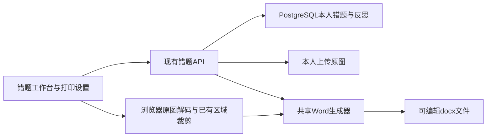

# 每日错题整理与剪贴打印：技术方案

**文档类型：** 技术方案
**需求类型：** 迭代型
**对应 PRD：** [每日错题整理与剪贴打印 v0.1.0](../daily-mistake-printing.md)
**版本：** v0.1.0 · **创建时间：** 2026年11月11日 20:21:19（北京时间） · **状态：** 核心范围本地实现及可用资料验证完成，未发布；纸面效果待验收

## 修改记录

| 版本 | 时间 | 内容 |
|---|---|---|
| v0.1.0 | 2026年11月11日 20:21:19（北京时间） | 根据已阅读代码提出核心范围的字段、接口、生成路径、迁移及验收设计 |

## AI 速读卡

- 本方案仅覆盖PRD推荐的REQ-DP01～REQ-DP06；REQ-DP07须先确定账号与权益归属。
- 技术选型：沿用vinext/React、Workers、PostgreSQL/pg、现有OOXML Word生成器和原图存储。
- 主要数据增量：`mistakes.reflection`；日期按既有`created_at`换算北京时间，不增加作业日期。
- 扩展已有列表、单题更新、单题/批量Word路由；网页转换与服务端共用模板选项。
- 核心风险：UTC归日、未保存反思、浏览器/服务端导出差异、原图不完整、跨账号访问。
- 已在独立PostgreSQL schema的真实资料副本及Workers预览进行验证；已通过项目类型、Word包检查和构建，详细结果见[交付记录](../../../delivery/features/daily-mistake-printing.md)。

## 一、概述与现状

现状分析依据：`app/dashboard.tsx`、`app/api/analyze/route.ts`、错题列表/删除/批量Word路由、`lib/mistake-docx.ts`、`lib/word-source.ts`、`lib/api-guard.ts`及`db/schema.ts`。现有普通用户没有错因更新接口；列表取全部本人错题，前端以UTC字符串截断分组；Word默认正文实际为10.5pt，历史Word规格写12pt，新剪贴版须显式使用12/14pt，不将旧样式当成新要求已满足。

## 二、系统边界与总体架构

系统边界：新增能力位于现有错题工作台及既有API内，不新建打印服务。硬约束是身份认证、原题完整和反思归属；推荐默认是无额外AI调用、单条反思保存；发挥空间仅限组件组织和排版实现。

技术选型不引入数据库替代、PDF服务或第三方打印SDK。可替换技术原则：复用现有生成器和图片转换能力；若发现真实兼容问题，先补验收证据，再评审替换依赖。

## 三、外部依赖

沿用现有PostgreSQL连接、R2兼容图片存储、浏览器Canvas及Word/WPS查看打印。不新增环境变量或AI依赖；无需安装专用打印机驱动。浏览器不能保证控制系统打印过程，下载完成只能报告文件已生成。

## 四、前后端通信协议

统一响应格式沿用现有约定：列表返回`mistakes`数组，单题更新返回`mistake`对象，导出为docx附件；错误沿用`{ error: string }`。不借此统一改造其他API。新增普通更新接口使用JSON，返回保存后的权威内容。所有响应与附件使用`Cache-Control: private, no-store`或等效禁止缓存策略。

## 五、核心业务流程

列表按日期、学科和搜索确定可见题目，选题后可编辑本人反思；保存成功更新列表与分析结果中同一ID的记录。打印前检查未保存更改，用户明确保存或放弃后才继续。生成器接收本次确定顺序的题目和打印选项，构建题目块与可选答案区；任一必需原图读取失败则整次失败。

## 六、模块拆分与边界

| 模块清单 | 拥有的数据/对外暴露 | 不负责 |
|---|---|---|
| 工作台 | 筛选、选题、未保存反思、打印设置与进度 | 鉴权、根据前端声明判断归属 |
| 错题API | 本账号错题读写、日期约束、生成前查库 | 调用AI代写本人错因 |
| Word生成器 | 题目顺序、模板参数、正文/反思/答案排版 | 数据库查询、账号和对象存储权限 |
| 原图访问 | 已有账号归属检查、图片内容读取 | 创建或猜测孩子资料归属 |

模块边界和依赖方向：UI→API→数据库/原图；UI或API→生成器。生成器不能反向访问UI状态或数据库。

## 七、目录结构

修改现有工作台与错题接口，新增`app/mistake-printing.tsx`及对应CSS承载打印设置和本人错因编辑。`lib/mistake-print-options.ts`集中类型、默认值与参数解析，服务端和浏览器共用。正式SQL追加在`db/migrations/`，Drizzle快照继续在`drizzle/postgresql/`维护。

## 八、状态设计

UI持有`selectedMistakeIds`、`reflectionDraft`、保存状态与`printOptions`；不将草稿写进原题数据，保存成功才替换记录。编辑失败保留草稿；生成失败保留选择、设置；改变日期/学科/搜索清空选择。状态机沿用PRD第五章，页面卸载清理本次Blob URL。并发编辑采用最后一次成功保存为准；本稿不承诺多人协同或版本历史。

## 九、前端设计

页面路由沿用工作台`?view=notebook`，增加`date=YYYY-MM-DD`或成对的`dateFrom`、`dateTo`，与`month`互斥。`subject`、`q`继续复用；浏览器前进/后退恢复条件。日期标题、过滤及文件名统一使用`Asia/Shanghai`，不能继续`slice(0,10)`归日。日期/月份切换由同一状态归一化逻辑控制。

打印设置提供选题清单及上下移动按钮，模板/字号/反思/答案/相似题控件遵循PRD。手机可滚动，操作按钮不遮挡正文；对话框管理焦点、Esc关闭和返回焦点。只给版式示意与选项摘要，不以网页预览宣称真实Word分页。

## 十、后端设计

所有输入使用既有参数化SQL。精确单日转为北京时间00:00至次日00:00的半开区间；区间用起始00:00至结束次日00:00。显式验证日期真实存在，不能让JavaScript把无效日期滚动到下一月。日期值严格验证后通过SQL参数传入，列侧保持`created_at >= $n AND created_at < $m`以利用现有索引；不能直接拼接日期或学科字符串。

请求同时携带互斥日期参数、缺少区间一端或起止颠倒时返回400。前端筛选、后端结果、日期分组和导出日期必须使用同一口径；旧无参数列表仍返回当前账号全部错题。

## 十一、接口设计

| 接口 | 增量契约 | 需求覆盖 |
|---|---|---|
| `GET /api/mistakes` | 可选`date`或`dateFrom/dateTo`，可选`subject/q`；返回每题`reflection`，原字段保留 | DP01、DP03、DP06 |
| `PATCH /api/mistakes/[id]` | 请求`{ reflection: string }`，仅允许更新该字段；1000码点上限；返回完整单题 | DP03、DP06 |
| `GET /api/mistakes/[id]/word` | 增加模板选项；无参数保持旧练习单契约 | DP04～DP06 |
| `GET /api/mistakes/word?id=...` | 继续限制服务端2～30个去重ID并保持传入顺序；增加同套模板选项 | DP02、DP04～DP06 |
| `GET /api/uploads/[id]/pages/[page]` | 复用既有原图读取与鉴权，不扩展公开访问 | DP05、DP06 |

统一选项：`template=worksheet|paste`、`fontSize=12|14`、`reflectionMode=saved-or-blank|blank|saved-plus-blank`、`includeAnswers=0|1`、`includeSimilar=0|1`。新增打印面板显式传全部选项；`paste`缺省取PRD默认值；完全无选项的旧调用保持旧模板。未知枚举返回400，不能在一个生成路径静默采用另一套默认值。

服务端从数据库获取真实反思，不能信任URL传入反思或题干。单题/批量均校验当前用户；批量只要缺失任一ID就返回404。客户端输入只允许控制模板选项和本人的已授权题目。

## 十二、数据设计

正式迁移为`db/migrations/0005_mistake_reflection.sql`。增加`mistakes.reflection text NOT NULL DEFAULT ''`及`char_length(reflection) <= 1000`检查约束，Drizzle schema、0005快照与journal同步。API用码点计数，不使用UTF-16的`string.length`判定1000个字符。迁移与校验和重复执行仅在独立schema验证通过，原库尚未迁移。

历史反思全部为空，不从AI解析回填。不新增日期表、打印历史表、档案字段或会员表；保存反思不修改`created_at`，防止题目跳日。新增列为向后兼容数据扩展，账号删除继续依赖现有级联关系。

## 十三、权限设计

列表、更新、原图、导出复用`authenticate()`；新的AI请求继续走`authenticateForAi()`。更新使用`WHERE id=$1 AND user_id=$2`并`RETURNING`，没有行返回404。沿用账号启停、删除标记及数据库写入触发器；角色无权绕过本人数据归属。按本次授权的推荐方案，权益到期仍可编辑本人历史反思。

## 十四、审计设计

本次不新增审计表或保存反思历史。业务日志不得包含学生反思、题干、图片、cookie、数据库连接串或密钥。错误日志只保留必要的操作类型和错误类别；复用既有日志设施。

## 十五、接口幂等

PATCH是设置字段值，重复相同请求只覆盖同一题字段，不新增错题。Word GET不修改业务数据；重复下载不会标记为已订正，也不重复消耗AI。前端禁用进行中的重复操作，不增加独立重试服务或后台任务。

## 十六、分页规范

本次沿用现有普通错题列表无分页契约，服务端日期过滤不改变返回形态；整日选择基于完整过滤结果。不得为了实现“选择全部”仅选当前屏幕行。后台列表分页不在本次改造范围；将来分页须另行定义整日全选的服务端契约，不能悄悄改变本期语义。

## 十七、错误码规范

错误码总表：400为日期/参数/反思文本不合法；401为未登录；403沿用账号或权益相关已有规则；404为题目不存在或不属于本人；503为认证存储暂不可用；其他数据库/生成错误按现有错误处理返回500且明确失败。新客户端依HTTP状态及`error`显示错误页面/局部提示，不解析堆栈或SQL错误原文。

## 十八、性能预算

沿用单次1～4张、单张8MB上传约束，上传分析不在本次提速范围。服务端合并继续最多30题；超过30题逐题在浏览器准备并展示`已处理/总题数`，不得静默缩小选题。字号和反思排版不得触发AI。没有真实设备测量基线，不给出未经验证的导出秒数承诺。

## 十九、可观测性

沿用已有服务日志与浏览器网络观察，不额外建设埋点、遥测或告警系统。验收记录题数、生成路径、文件能否打开和打印核对结果，失败记录具体操作类别；敏感内容不入日志。缓存策略按第四章执行。

## 二十、安全设计

反思作为纯文本渲染，生成OOXML前走现有XML转义；不得用`innerHTML`渲染学生输入。错误响应不泄露跨账号存在性。反思编辑沿用现有同源会话规则，不新增跨域写入入口。真实账号和资料只在已获准范围使用；破坏性验证在独立PostgreSQL数据库或schema的真实资料副本中进行。

## 二十一、兼容性

现有服务端原图加载器只返回整页JPG/PNG，现有浏览器`sourcePicture()`能根据区域裁剪，不能宣称服务端已经会裁剪。剪贴版遇需要原图且有合法区域的题，优先走浏览器裁剪；WEBP或超过30题也走浏览器。没有区域的JPG/PNG可继续服务端整页输出并提示核对题号；不在本次引入服务端图片处理依赖。

生成器让剪贴原图按可打印宽度等比排版，不能继续用会把长图压得很小的统一高度上限冒充字号可读。长图是否需重新上传局部图片须明确提示；不自动切碎关键图表。服务端与浏览器共用选项与排版函数，原图范围差异应显式标注。

旧练习单继续默认包含既有举一反三、答题区域与答案区；新剪贴版的默认设置只在新模板生效。保留数学公式OOXML、图片关系、页码、附件文件名和下载方式，JPG/PNG直接下载仍优先用于可服务端生成的情况。

## 二十二、代码改动清单

| 文件 | 实现内容 |
|---|---|
| `app/dashboard.tsx`及实际使用的工作台样式 | 日期与选择、反思编辑、打印设置、生成路径和进度 |
| `app/api/mistakes/route.ts` | 日期过滤与反思返回 |
| `app/api/mistakes/[id]/route.ts` | 新增PATCH，保留DELETE |
| `app/api/mistakes/[id]/word/route.ts`、`app/api/mistakes/word/route.ts` | 查询反思并传入归一化模板选项 |
| `lib/mistake-docx.ts` | 类型扩展、剪贴模板、字号、反思及答案选项、对应文件名 |
| `lib/mistake-print-options.ts`（新增） | 共享打印选项与验证，不拥有业务数据 |
| `db/schema.ts`、新正式迁移、PostgreSQL快照 | 反思列与字符长度约束 |
| `scripts/check-mistake-docx.mjs` | 仅按需要补充用户可见版式/原题完整性验证；不测试源码字符串 |

新增API字段还应核对实际调用方，包括管理员编辑与导出是否需要展示本人反思；默认不把管理员的AI解析编辑动作变成修改学生反思。修改导出符号前查引用并迁移所有真实调用方，不建立兼容别名。

## 二十三、部署与上线

批准后先备份真实PostgreSQL与对象存储，再追加和执行迁移，核对存量数据、关系和原图。仅在用户另行授权发布后按既有部署流程执行；本稿不授权提交或上线。旧程序忽略新增反思列，新程序要求迁移已完成；回退应用时保留列和用户内容，不删除反思来回滚。

文档随实施同步；现有`0004_question_bounds.sql`的上线先决条件仍须满足。Windows构建前停止本次启动的预览进程，不终止其他任务进程。

## 二十四、测试与验收

测试策略：使用获准的真实账号与真实资料；先验证新增反思和日期边界，再验证真实Workers HTTP、浏览器交互、Word/WPS和纸面效果。构建、类型检查、文档检查不能代替实际运行。以下为待执行验收剧本，当前均未执行。

1. **验收剧本1（S1）：按天汇总。** 前置：真实账号的跨批次错题，含北京时间边界记录。动作：选择今日、指定日和区间。证据：记录ID集合、题数和URL恢复结果，各日不漏不重。
2. **验收剧本2（S2）：反思闭环。** 动作：保存多行反思、清空、超过1000码点、断网保存再重试。证据：刷新后持久内容正确，错误保留草稿，AI解析保持原值。
3. **验收剧本3（S3）：剪贴输出。** 前置：真实文字/公式/图表题。动作：选择12/14pt、三种错因方式、答案开关。证据：Word/WPS可打开，导出顺序、反思、图表和纸面无截断，短题不无故拆页。
4. **验收剧本4（S4）：两种生成路径。** 前置：真实JPG/PNG、WEBP、有/无区域和超过30题记录。动作：生成文件，读取原图失败后重试。证据：设置语义一致、无静默截断；图片缺失时不给残缺文件。
5. **验收剧本5（S5）：账号与权益。** 前置：普通账号、另一个账号、权益到期账号。动作：构造未登录和跨账号读写。证据：401/404/权限规则符合PRD，历史整理无AI请求。
6. **验收剧本6（S6）：旧功能回归。** 动作：使用旧单题/批量练习单、原举一反三、单元卷。证据：无模板参数的旧调用行为保持，新字号只作用于新选项。

实施时按变更执行适当的现有检查：`node scripts/check-mistake-docx.mjs`、`npx tsc --noEmit`、`npm run build`和`npm run lint`。还须在Workers预览验证HTTP、在浏览器操作实际页面；打印至少核对一份真实A4样张。没有WEBP、31题以上真实资料或真机时如实标记对应未验证项，不用虚构数据填补证据。

## 二十五、开发者交接说明

实现顺序：确认PRD第九章范围与日期口径 → 迁移和接口 → 日期/反思UI → 模板与两种导出路径 → 真实验收 → 同步操作说明及交付记录。需求覆盖由第十一章接口表和第二十四章S1～S6承接；多孩REQ-DP07只保留评审需求，不在核心代码中提前加入空档案字段。

已知的未知项：真实家庭打印设备、长图纸面可读性和大批量浏览器内存上限仍待实测。决策记录：用户已授权按推荐核心方案实施，无新增依赖、不改变AI分析、复用账号与归属；D1～D3按推荐方案实施，D4多孩与收费继续待决。真实资料不足的验收场景不标为通过，证据以交付记录为准。

## Documentation Sync

本稿与PRD对应同一v0.1.0核心范围；用户已授权按推荐方案开发，接口、迁移、工作台与生成器已实现。日期筛选复用客户端完整列表，同时API提供相同口径过滤；导出前重新校验当前记录，服务端附件在独立下载框架中请求，失败返回时保持页面和设置。共享打印选项已同时接入两种路径；当前数据库、运行验证与剩余实测边界见[交付记录](../../../delivery/features/daily-mistake-printing.md)。本次未发布，不更新已发布CHANGELOG。
