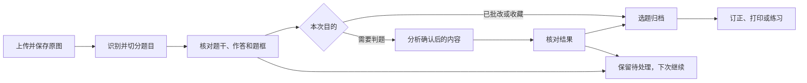
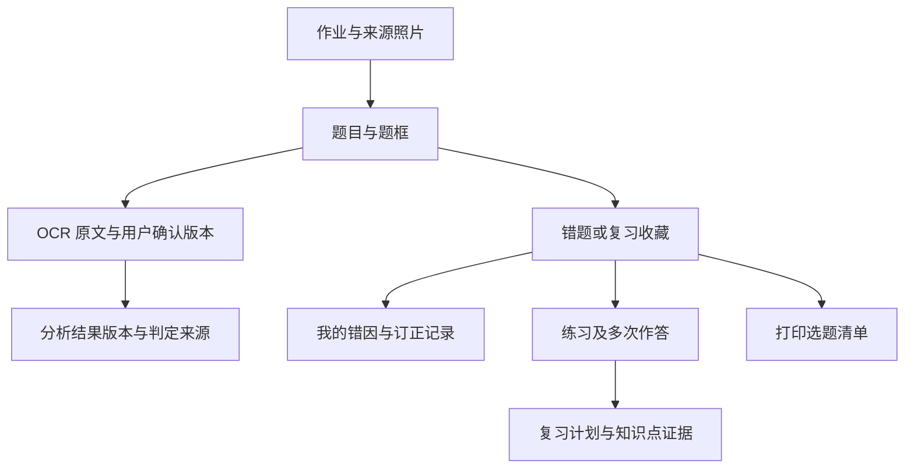

# 拾题功能重构方案：从上传分析到错题整理与复习

## 1. 设计结论与范围

建议将产品定位为：**帮助学生和家长，把日常作业中不会、做错或需要再练的题，整理成可信、可打印、可持续复习的学习资料。**

主要使用场景以此前明确的“家长晚上整理作业、学生填写错因、打印贴本”为设计起点；学生自主练习与作文分析继续支持。这是本方案的优先级假设，不代表已完成用户调研或决定更换目标客户。

把作业作为资料入口，把题目作为学习资料，把复习中的实际作答作为进步证据。OCR、解题模型、出题和知识点聚合是实现能力，用户的主操作应围绕下一件需要完成的事组织。

本文件为功能设计提案，不是实施完成报告。当前代码事实依据本轮源码核查及[使用流程 Review](../../delivery/features/product-flow-review.md)。本轮没有开展新的页面视觉/无障碍专项审计，也没有验证新方案的使用效果。已有本地修复、正式部署和拟议能力分别标明，不混为同一状态。

## 2. 当前设计为何容易出问题

| 当前事实 | 用户受到的影响 | 设计上的原因 |
| --- | --- | --- |
| 之前完整结果仅在页面内存，历史等同于错题；本地已补持久化与独立历史 | 上传过却像没有使用过 | 把上传资料、处理任务、判题结果、归档题目混成一个概念 |
| 当前任务状态为 processing/completed/failed，已完成也可能全部待核对 | “完成”与“可以放心使用”不一致 | 系统执行状态与用户完成状态混用 |
| `analyzePages` 对低置信度或含配图题强制 uncertain，且没有确认编辑入口 | 用户停在“待核对”，只剩重新拍照或重试 | 有拒绝机制，没有恢复任务的操作流程 |
| 首次上传后立即进入模型分析，用户尚未确认题目与作答 | 识别错误进入分析，浪费时间和调用费用 | 识别、确认、判题没有分阶段提交 |
| 只有判定错误的题才能自动进入错题本 | 已知老师判错、不会做的空白题、想收藏的图形题都难以整理 | 收藏学习资料过度依赖自动判题 |
| 单元练习与举一反三能出题，生成内容不等于完成作答 | 工具丰富，学习任务却没有连续性 | 缺少订正、复练、再次查看的联系 |
| 练习卷只保存一组答案和最近一次 grading | 重做会覆盖上次结果，难以判断变化 | 缺少独立的练习轮次 |
| 错题 DELETE 直接删业务行 | “不想显示”“已订正”“永久删除”容易混淆 | 学习状态、集合关系与资料删除没有区分 |
| 学科名称来自模型自由文本，例如“数学/小学数学” | 同一学科可能被拆成两个分类 | 分类没有稳定标识与统一规则 |
| 首页并排陈列上传、图谱、练习、作文和统计 | 用户需要自己判断哪个入口适合当前任务 | 功能展示优先于任务引导 |

不建议通过降低识别阈值、放开配图自动判题来解决“待核对过多”。需要的是可确认、可手动整理、可保留待办的路径。

## 3. 信息架构

### 推荐主导航

| 一级入口 | 要回答的问题 | 核心内容与主操作 |
| --- | --- | --- |
| 今日 | 我现在先做什么？ | 继续上次任务；待核对、待订正和到期复习；上传新作业；今日整理打印 |
| 作业 | 拍过的资料在哪里？ | 所有上传；处理进度；原图；逐题确认；分析报告；失败恢复 |
| 错题本 | 哪些题值得再看？ | 已归档题、不会做的题、复习收藏；错因与订正；按日整理；导出 |
| 练习与复习 | 接下来练什么、做得怎样？ | 原题重做、针对练习、单元练习；未完成练习；多次作答记录 |
| 作文 | 原文、修改与报告如何保存？ | 作文草稿、确认原文、反馈、修改稿和历史报告 |

桌面侧栏与手机底部导航使用同一命名和顺序。全局“上传”按钮按当前入口预选“作业/作文”，其余入口可选择；不同时放置多个含义近似的“拍错题/上传/开始分析”按钮。

“分析记录”合并到“作业”作为同一批资料的不同状态，不再长期维持一个历史页和一个结果页的重复导航。“当前分析记录”改成作业内部的详情位置或面包屑。

“知识图谱”收进“练习与复习 → 知识点回顾”，保留能力和来源证据，降低入口优先级。第一版以可点击的知识点列表表达“相关错题、最近作答、建议练习”，图形视图可作为切换方式。

“整理打印”放在今日与错题本选题后的操作区，直接关联待打印资料。账号、会员和设置放在用户菜单；管理员后台独立。会员权益和价格沿用现状，本方案不变更计费。

### 首页布局

1. 顶部：“继续上次任务”与“上传新作业”；不存在未完成任务时，前者自然隐藏。
2. “今天要处理”：待核对题、待订正题、到期复习。数量按真实对象计算，点击直达待办对象。
3. “今天整理与打印”：跨作业选择资料，显示待核对数量，默认只选已确认的归档资料。
4. “最近作业”：名称、学科、作业日期、上传时间、已保存状态及下一步；无错题也显示。
5. 次要“学习回顾”：近期实际完成复练、常见知识点；有数据才显示，不用虚构的掌握率填空。

首页不要求所有人按固定顺序完成所有模块。家长可上传后直接整理打印，学生可直接打开未完成练习。

## 4. 三种入口意图

上传前只询问一个重要问题：**“这次要做什么？”** 不要求用户配置 OCR 参数。

| 意图 | 用户已有的信息 | 默认路径 | 不做的推断 |
| --- | --- | --- | --- |
| 整理已批改作业 | 老师已圈出错题或家长知道错题 | 上传 → 核对/圈选错题 → 归档或打印；解析可按需生成 | 不凭 OCR 猜测红笔叉号或扣分意义 |
| 检查未批改作业 | 有题目和学生作答，需要辅助判题 | 上传 → 确认题目和作答 → 分析 → 核对结果 → 归档选定题目 | 不把空白题直接判错，不把不确定题当正确 |
| 收集一道题 | 有想保留、不会做或需要复习的题 | 上传/手动裁剪 → 确认来源 → 收藏；可补文字和解析 | 不要求先判断对错才能保存 |

首选项根据用户上次选择预选，仍能切换。三个意图共享资料结构与历史页，不创建三套隔离资料库。

每次作业可补充名称、学科、作业日期，默认名称可编辑、日期默认当天。学科使用固定标识，年级单独保存；模型只能提供建议，用户可以更正。既有“数学/小学数学”需按显式映射合并到数学，保留原标签供追溯。

## 5. 作业的完整流程

### 5.1 拍照与保存

- 上传前支持页序调整、旋转、删除和清晰度提示；旋转后的 OCR 必须使用与题框一致的图像版本，原始照片不覆盖。
- 第一版继续接受当前 JPG/PNG 和现有限制；超限时给出具体原因。WEBP/HEIC 转换作为独立增强，未经实现与验证不在页面承诺支持。
- 选中文件仅在本机时标为“尚未上传”；服务端确认对象与索引后才显示“原图已保存”。上传部分成功时按页重试，不能让已完成页随失败页丢失。
- 在运行识别前已经有可访问的作业记录。关页、刷新和重进后可从作业继续。再次提交用请求标识防重复；同账号相同文件可提示“已上传，打开现有作业/仍然新建”，不能静默误合并相同模板的不同作答。

### 5.2 逐题核对：本次最优先的产品能力

桌面为“左原图、右题目列表/当前题目”；手机为单题卡，上方查看原图，支持定位到题框、切换下一题，避免同时挤入两列。

每题至少有：原题号（与系统 ID 分开）、题干、选项、学生作答、参考答案（若有）、题框与配图、缺失信息说明。

用户操作：

- **文字无误**：一键确认本题；可靠且完整的多题可批量确认，明确选中范围。
- **修改文字**：编辑题干/选项/作答；保存为确认版本，原 OCR 保留；公式提供预览和简单输入帮助，不要求用户编辑 JSON。
- **调整题框**：修正裁剪范围，避免将相邻题和答案混入；合题、拆题与手动新增题逐步实现，第一版至少能手动框选一道题。
- **保留图片整理**：复杂几何、图表、公式不能完整确认时，以原题图片归档/打印；标记“待补解析”。不重新启用视觉大模型识字，也不承诺文字模型能理解图形。
- **暂不处理/忽略残题**：照片边缘残题、页眉不进入判题；忽略可撤销，原图仍在。
- **补充参考答案**：用户提供老师答案时标注来源，不能和学生作答合并。

题目识别置信度作为定位问题的信号，给用户“哪一段需要核对、如何处理”，不让用户面对一个百分比自行判断。只重新识别选定页/区域，不为修改一句文字重跑全部照片。

### 5.3 分析与确认

- 用户主按钮根据意图显示“确认并整理”或“确认后分析”；旁边显示将处理的题数及已有保存状态。
- 分析只读取用户确认的题目版本；未确认题可暂存，不能混入确认批次。图形信息不足的题不触发无法完成的自动判题，可走图片归档。
- 分析结果分类为“判对、判错、无法判断、未作答”；教师/家长手动认定和模型建议明确区分来源。
- 模型发现题干缺项时指出需要补充的内容；不给“全部待核对”且无操作出口的结束页。
- 首期建议显示候选错题并让用户批量确认归档。后续可提供“自动归档可靠结果”的偏好，但必须可追溯、可撤销；不默认将模型建议等同于用户确认。
- 用户手动认定错题可不调用模型直接归档，“我的判定”不伪装成机器验证。不会做/未作答可归入学习收藏，保留原状态，不改写成答错。
- 分析成功后资料已保存，用户可以暂不归档。修改题目产生新版本，旧分析标为“基于旧内容”，重新分析前显示影响范围；不静默覆盖旧结果和错因。

## 6. 错题本：从资料集合变成可以处理的学习清单

列表默认显示学科、原题摘要/缩略图、来源日期、当前学习阶段与下一步。筛选保持简短：学科、日期、待订正、待复习；关键词支持题干、来源与知识点。详细筛选收在展开区。

一张详情页聚合原题、自己的作答、正确答案/解析、我的错因、订正、练习记录、来源作业。答案默认折叠，原题优先。家长整理模式可以直接进入选题与打印；学生练习模式先显示题目再显示提示和答案。

建议的动作含义：

| 动作 | 结果 |
| --- | --- |
| 从错题本移除 | 解除归档，保留来源题目、分析、作答及旧练习；提供撤销 |
| 完成订正 | 保存一次学生订正或“已在纸上订正”的自述，不声称自动判定已掌握 |
| 稍后复习 | 加入可调整的复习计划；只影响安排，不改写对错 |
| 已能独立做出 | 保存用户自述或实际复做证据，来源分别标记 |
| 删除作业/资料 | 单独进入资料删除流程，列明影响及保留选项；不能因移除一题删除整份原图 |

学生自己的错因与 AI 解题思路继续分开。可以选错因标签辅助整理，但不自动写成学生已反思。空着的错因能打印留白，不以填完所有字段作为使用门槛。

## 7. 打印、练习与复习的安排

### 7.1 打印是主要出口

保留现有“剪贴版”和“练习单”，默认优先完成今日多份作业的整理。流程为：日期/学科选题 → 去重与排序 → 错因/留白 → 答案位置 → 下载 Word。原图有学生答案和教师批注时显示预览提示，不承诺自动去笔迹。

不把下载文件当作“已打印”，不把“已打印”当作“已订正”。可保存本次选题清单，生成失败后保持设置；对同一批资料再次导出不重复分析、不改变学习状态。

### 7.2 练习集中在一个入口

- “原题重做”：来源于已归档题，先隐藏原作答和答案；图片含答案无法隐藏时应提醒，可改用确认后的题干或生成变式题。
- “针对练习”：从一题或一组已确认错题启动，默认少量，保留与原题关系；复用已生成但未做的练习优先于再次生成。
- “单元练习”：保留自主设定范围、知识点、题量和题型；生成前展示范围，生成后立即保存。
- 每次作答建立独立轮次，重做不覆盖上次答案。记录实际作答、评分来源、时间和待核对项，保留连续变化。
- 页面离开后草稿应能找回，已提交轮次不可被未提交草稿污染。首期完成服务器端草稿；跨设备并发编辑需提示版本冲突。

### 7.3 复习先做轻量版本

先支持“以后再看/明天/指定日期”和手动调序，不直接宣称提供经过验证的智能遗忘曲线。今日出现到期清单；完成一次复做后再安排下次，用户可跳过。

学习回顾展示：实际复做次数、最近对错、不同日期的表现和未解决题。不要用上传量、生成量或一次做对推算掌握率。知识点回顾中的每个数字都能跳到具体题目和作答证据。

## 8. 作文作为独立工作流

沿用原文确认优先，补齐“作文草稿 → 识别原文 → 用户核对 → 分析报告 → 学生修改稿 → 再次反馈”的连续资料。

- 草稿文字自动保存；切换页面能继续编辑。照片当前规格只用于当次处理、不长期保存，维持这一约束；如果需要照片跨设备恢复，另行评审保存周期、删除机制与告知，不随此次导航改造暗中扩大存储范围。
- 题目要求、学生原文、教师批注、AI 建议、学生修改稿分别保存，不把润色稿覆盖为学生原文。
- 每次报告绑定对应的原文版本。重新分析先展示使用的版本与调用动作，历史读取不重复收费请求。
- 书写评价在当前仅文字分析能力下隐藏或明确“不提供”，不显示看似完整却没有图像依据的评分卡。
- 作文不自动变为普通错题、知识点错误次数或单元练习统计，保留独立历史和评价方式。

## 9. 保存、状态与费用：统一交互规则

不能用一个状态字段代表所有事情。至少分开以下维度，并按用户当前需要组合展示：

| 维度 | 推荐表达 | 重要区别 |
| --- | --- | --- |
| 资料保存 | 仅在本机、上传中、已保存、部分失败 | “已选照片”不等于服务端已保存 |
| 处理进度 | 识别中、待核对文字、分析中、结果已保存、处理失败 | 可恢复任务与用户学习进度分开 |
| 每题判定 | 未分析、判对、判错、无法判断、未作答；附来源 | 空白/未知不等于错误 |
| 归档关系 | 未归档、已归档、已移出 | 学习资料仍能存在于原作业中 |
| 学习动作 | 待订正、已订正、待复习、已复做；附证据 | 不用一次动作计算“掌握” |

任务可以部分完成：例如“一份作业 10 题，6 题已确认，4 题待核对”，可先整理其中 6 题；不把整份作业锁死。待办数量按题计，作业数量按份计，页面标出单位。

自动保存要显示“正在保存/已保存/保存失败”，失败保留输入且提供重试。只读历史、改名、筛选、核对文字、保存错因、打印已保存资料不调用 AI。识别、重新识别、分析、重新分析、生成练习为明确外部调用动作；按钮附近说明范围，具体计费规则不在本方案猜测。

外部服务失败不反向删除已经保存的用户资料。额度到期或服务不可用时仍能查看、整理、修改用户自己的内容并导出；需要外部调用的步骤再校验权益。持续后台执行需要持久任务队列，不能只加一个“可放心关闭页面”的文案。

## 10. 支撑功能的资料关系

题目需要稳定 ID，不能只靠“第几页第几个”定位。修改题框、识别版本、归档和多次练习通过关系关联，同一道题不因重新分析被重建成多份错题。归档动作使用唯一性约束，保留来源和修改者；重复点击、超时重试、刷新返回不应重复扣调用或生成资料。

这是概念模型，不是要求立刻按图新建所有表。保留现有用户 ID、上传 ID、原图键和错题 ID；通过追加迁移逐步接入。已保存的作文和练习不强制塞进普通作业表。

## 11. 重构顺序与每阶段验收

| 阶段 | 交付内容 | 必须通过的任务 |
| --- | --- | --- |
| 0：巩固现有修复 | 历史可恢复、错误状态清楚、分类规范、旧记录迁移核验 | 上传后刷新/重登找回；零错题与全待核对仍有记录；失败不丢图；账号隔离；主服务重启后结果不变 |
| 1：完成整理主流程（最高优先） | 作业列表/详情、稳定题目 ID、核对编辑、手动图片选题、确认归档、保存版本 | 真实低置信度照片能改好一题并归档；图形题可只保留原图整理；残题可忽略；修改后旧分析不冒充当前结论；不重复归档 |
| 2：重排入口和整理效率 | 今日待办、今日跨作业整理、打印批次、标准学科、移除/撤销 | 家长从两份作业选题并生成 Word，刷新不丢选择清单；内容/公式/图形齐全；不触发额外 AI 调用 |
| 3：完成复练流程 | 原题重做、针对练习、独立作答轮次、服务器草稿、轻量复习安排 | 第一次错、第二次对的记录同时存在；未做的生成题不计进步；错题与来源练习可互相追溯 |
| 4：作文和进度完善 | 原文/修改稿版本、草稿恢复、知识点回顾与证据 | 报告与对应原文一致，修改稿不覆盖原稿；历史阅读不再调用模型；所有统计能回到实际证据 |

建议第 1 阶段先落地，再调整全站导航。完整流程跑通之前大改首页外观，会继续让用户遇到更漂亮的中断点。

每阶段独立本地验证、数据库备份和上线评估，不进行全库重建。新旧详情链接兼容跳转，旧题保留原图来源，已有错因、类似题、打印行为不能因实体拆分丢失。

## 12. 验收方式与建议指标

不把“API 返回 200”“有记录”“出现成功页”当作产品验收。至少验收：

1. 家长整理已批改作业：不借助自动判题，确认并归档选定题，填/留空错因，跨作业打印。
2. 学生检查未批改作业：先确认内容，得到可解释结果；不确定题有下一步，不伪装成正确。
3. 低置信度/复杂图形：保存、修正文句或仅图片收藏均可；不降低阈值强行分析。
4. 刷新、断网、外部余额不足、重启、重复提交：已保存资料和编辑不丢失，任务可恢复，成功资料不重复生成。
5. 更正题干：旧版本和报告保留但标注过期，重新分析只针对变更内容。
6. 订正与复练：实际作答、用户自述、模型建议来源清楚，重做保留各次记录。
7. 账号/权益：跨账号不可见，读取本人历史和非 AI 整理不因试用到期失效。

建议采集“上传保存成功率、题目确认完成率、待核对恢复率、归档后打印/复做完成率、任务中位耗时、失败恢复率、每次有效整理的外部调用次数”。先建立真实基线再设目标；不编造提升比例。日志只记录必要状态和耗时，不默认收集学生题目全文与照片。

## 13. 明确暂缓的设计

- 多孩档案：已有需求但未确定账号/会员方案。本轮保持当前账号隔离，未来显式决定后再做跨模块档案切换。
- 教师班级、家校提交、社交排名：缺少当前使用验证，先不扩大角色与权限。
- 全自动批改所有图形/手写题、自动去笔迹：能力尚未验证，不以交互文案作能力承诺。
- 成绩预测、掌握百分比、自动填写学生错因：当前证据不足，不添加推断性结论。
- 复杂图谱、每日推送、强制打卡：先保证用户回来时有可继续的真实任务；提醒如需发送另行明确授权和渠道。

## 14. 本方案与已有规格的关系

- [使用流程 Review](../../delivery/features/product-flow-review.md)：当前发现、已经实施的恢复修复及实测边界；本提案不将拟议能力计为已交付。
- [每日错题整理与打印](daily-mistake-printing.md)：保留原题完整、反思独立、非 AI 导出、已有两种模板；新设计增加确认、资料关系与保存清单，不撤销已上线功能。
- [作文原规格](essay-analysis.md)：当前部分内容包含早期 D1/视觉识别方案，具体实现以现有 PostgreSQL/百度 OCR 代码为准；如进入实施，需同步更新有效规格，照片保存范围不得隐式扩大。
- 管理员后台保留独立管理入口。新增待办、任务、版本和删除关系时同步管理端说明，但不把开发服务配置暴露给学生。

下一步建议：以“作业题目核对与确认归档”为首个实施规格，细化逐题编辑、图片选题、版本失效、手动归档和真实验收；导航与首页跟随该流程调整。
